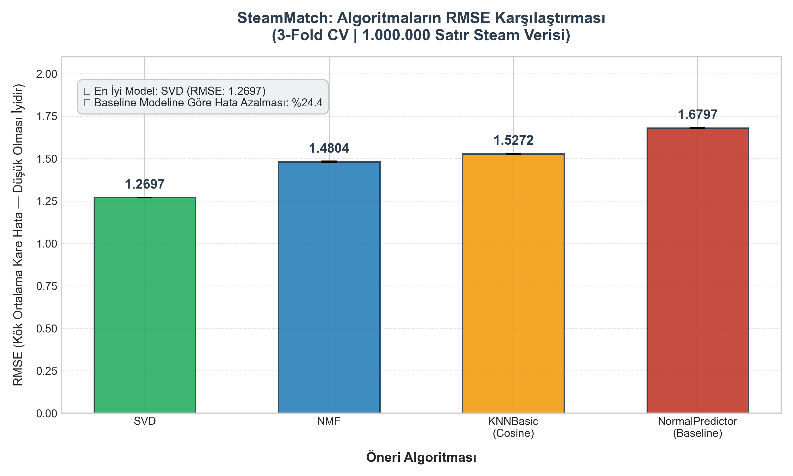
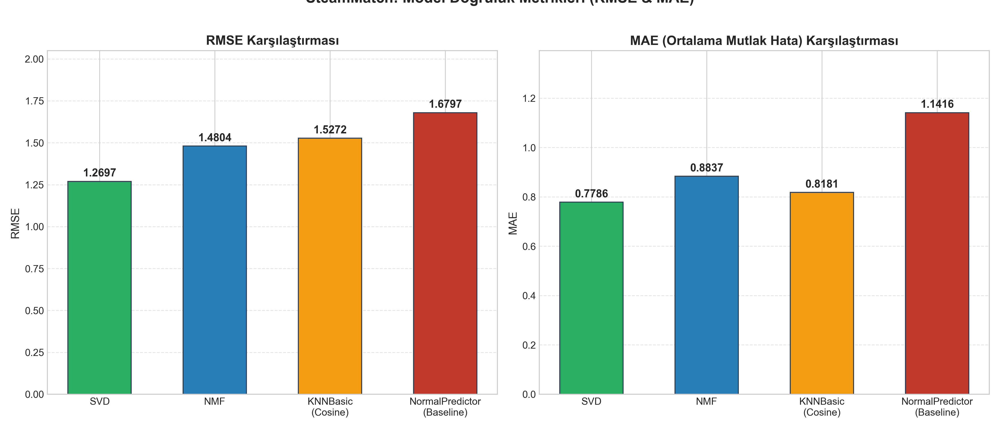

# 🎮 SteamMatch: Yorumlara Dayalı Oyun Öneri Sistemi
### *Veri Madenciliği (Data Mining) Dersi Dönem Projesi*

---

## 📌 1. Projenin Adı ve Amacı

* **Proje Adı:** SteamMatch: Yorumlara Dayalı Oyun Öneri Sistemi (*Game Recommendation System*)
* **Problem Türü:** İşbirlikçi Filtreleme (*Collaborative Filtering*) Tabanlı Tavsiye Sistemi
* **Kullanılan Kütüphane:** Python `scikit-surprise`, `pandas`, `numpy`, `matplotlib`

### 🎯 Projenin Amacı
Dijital oyun dağıtım platformu Steam üzerinde milyonlarca kullanıcı, satın aldıkları veya oynadıkları oyunlar hakkında yüz binlerce inceleme ve tavsiye paylaşmaktadır. Bu projede amaç; kullanıcıların oyunlara verdikleri **duygu durumu (tavsiye edip etmeme) geri bildirimlerini** sayısal bir derecelendirme (rating) matrisine dönüştürerek, kullanıcılara ilgilerini çekebilecek yeni oyunları yüksek doğrulukla tavsiye eden ölçeklenebilir bir **Öneri Sistemi (Recommendation System)** geliştirmektir.

---

## 📊 2. Veri Seti Detayları

* **Veri Seti İsmi:** Steam Review Dataset
* **Araştırmacı / Kaynak:** Antoni Sobkowicz ([Kaggle / Zenodo Veri Tabanı](https://www.kaggle.com/datasets/antonisobkowicz/steam-review-dataset))
* **Ham Veri Büyüklüğü:** ~8.17 GB, **21.747.371 (21.7 Milyon) Satır** 
  * `author.steamid`: Kullanıcının benzersiz Steam ID kimliği.
  * `app_id`: Oyunun Steam platformundaki benzersiz uygulama kimliği.
  * `recommended`: Kullanıcının oyunu tavsiye edip etmediği (`True` = Pozitif, `False` = Negatif).
  * `review`: Kullanıcının yazdığı serbest metin yorumu.
  * `votes_helpful`, `playtime_forever`, `timestamp_created` vb. yan metaveriler.

---

## ⚙️ 3. Veri Ön İşleme (Data Preprocessing) Adımları

Büyük boyutlu verilerle çalışırken karşılaşılan en temel kısıt **bellek (RAM)** ve **seyreklik (sparsity)** problemidir. Bu doğrultuda aşağıdaki adımlar titizlikle uygulanmıştır:

### 3.1. Bellek (RAM) Optimizasyonu — usecols Yaklaşımı
* `review` sütunu, ham veri setinde yüz binlerce kelimelik serbest metin barındırmaktadır. Bu metinlerin belleğe alınması onlarca Gigabyte RAM tüketimine ve `MemoryError` çökmesine yol açmaktadır.
* pandas kütüphanesinin `usecols` parametresi kullanılarak yalnızca öneri motoru için zorunlu olan **üç sütun** belleğe alınmıştır:
  * Kullanıcı Kimliği: `author.steamid` (`int64`) $\rightarrow$ `user_id`
  * Oyun Kimliği: `app_id` (`int32`) $\rightarrow$ `game_id`
  * Duygu Durumu: `recommended` (`bool`)
* Bu optimizasyon sayesinde 21.7 milyon satırlık devasa veri kümesi **sadece 269.6 MB RAM** tüketilerek 17 saniyede belleğe yüklenmiştir.

### 3.2. Sentiment $\rightarrow$ 1-5 Rating Matrisi Dönüşümü
Kullanıcıların ikili (binary) tavsiye durumları, standart tavsiye algoritmalarının beklediği 5'li Likert ölçeğine haritalanmıştır:
$$\text{Rating} = \begin{cases} 5, & \text{eğer } \text{recommended} = \text{True (Pozitif Yorum)} \\ 1, & \text{eğer } \text{recommended} = \text{False (Negatif Yorum)} \end{cases}$$
Aynı kullanıcının aynı oyuna birden fazla yorum yazmış olma ihtimaline karşın `(user_id, game_id)` çiftleri tekilleştirilmiştir (`drop_duplicates`).

### 3.3. Seyreklik Azaltma (Sparsity Reduction) ve Filtreleme
Tavsiye algoritmalarında komşuluk veya gizli faktörleri doğru yakalayabilmek için aşırı seyrek veriler filtrelenmiştir:
1. **Oyun Filtresi:** En az **50 yorum** almış popüler ve güvenilir oyunlar tutulmuştur.
2. **Kullanıcı Filtresi:** En az **5 farklı oyunu** oylamış aktif kullanıcılar filtrelenmiştir (Cold-start etkisini azaltmak amacıyla).
3**Deterministik Örneklem:** Çapraz doğrulama deneylerinin tekrarlanabilirliği ve hız dengesi için tam **1.000.000 satırlık** dengeli örneklem (`random_state=42`) seçilmiştir.

---

## 🧠 4. Karşılaştırılan 4 Algoritma ve Seçilme Nedenleri

Projede `scikit-surprise` kütüphanesinin temelini oluşturan, öneri sistemleri literatüründeki 4 farklı felsefeyi temsil eden algoritmalar seçilmiştir:

| Algoritma | Metodoloji | Neden Seçildi? |
| :--- | :--- | :--- |
| **1. SVD (Singular Value Decomposition)** | Düzenlileştirilmiş Matris Ayrıştırma (*Matrix Factorization*) | Netflix Prize yarışmasının kazanan temel mimarisidir. Kullanıcı ve oyunlar arasındaki gizli eğilim faktörlerini (*latent factors*) öğrenir ve seyrek matrislerde en yüksek genelleme başarısını gösterir. |
| **2. NMF (Non-negative Matrix Factorization)** | Negatif Olmayan Matris Ayrıştırma | Faktör matrislerinin elemanlarının negatif olmasını engeller. Öneri sistemlerinde yalnızca pozitif katkıların toplanabilirliğini (*additive parts-based representation*) modellemek için teorik olarak tercih edilir. |
| **3. KNNBasic (Cosine)** | Bellek Tabanlı Komşuluk Filtreleme (*Item-based Collaborative Filtering*) | Oyunlar arasındaki açısal kosinüs benzerliğini (*cosine similarity*) hesaplayarak benzer oyunları önerir. Sezgisel olarak açıklanabilirliği yüksektir. |
| **4. NormalPredictor (Baseline)** | Normal Dağılım Tabanlı Rastgele Tahmin | Eğitim verisinin ortalama ve standart sapmasını öğrenerek rastgele tahmin üretir. Diğer algoritmaların anlamlı bir örüntü yakalayıp yakalamadığını kanıtlayan referans taban (*ground truth baseline*) modelidir. |

---

## 📈 5. Sonuçlar ve Değerlendirme

Tüm algoritmalar **3-Katmanlı Çapraz Doğrulama (3-Fold Cross-Validation)** ile değerlendirilmiş; **RMSE (Kök Ortalama Kare Hata)** ve **MAE (Ortalama Mutlak Hata)** metrikleri hesaplanmıştır.

### 5.1. Performans Karşılaştırma Tablosu

| Sıra | Algoritma | Test RMSE (Ortalama) | RMSE Standart Sapma | Test MAE (Ortalama) | MAE Standart Sapma | Eğitim / Test Süresi |
| :---: | :--- | :---: | :---: | :---: | :---: | :---: |
| 🥇 | **SVD** | **1.2702** | $\pm 0.0034$ | **0.7772** | $\pm 0.0029$ | ~5.66 sn |
| 🥈 | **NMF** | **1.4814** | $\pm 0.0016$ | **0.8904** | $\pm 0.0015$ | ~6.38 sn |
| 🥉 | **KNNBasic (Cosine)** | **1.5251** | $\pm 0.0024$ | **0.8166** | $\pm 0.0007$ | ~5.18 sn |
| 4 | **NormalPredictor (Baseline)** | **1.6812** | $\pm 0.0014$ | **1.1429** | $\pm 0.0010$ | ~5.01 sn |

### 5.2. Grafiksel Sonuçlar

#### 📊 RMSE Karşılaştırma Grafiği
Aşağıdaki grafikte 4 algoritmanın RMSE değerleri yan yana karşılaştırılmıştır. Değerin küçük olması tahmin hatasının daha düşük ve modelin daha başarılı olduğunu gösterir:



#### 📊 RMSE ve MAE Birlikte Karşılaştırması


---

## 🔍 6. Akademik Bulgular ve Yorumlar

1. **SVD'nin Üstünlüğü:** SVD algoritması **1.2702 RMSE** ve **0.7772 MAE** ile tüm modeller arasında açık ara en yüksek doğruluğu sağlamıştır. Bunun temel nedeni, SVD'nin derecelendirme matrisini gizli faktör vektörlerine indirgeyerek aşırı uyumu (*overfitting*) $L_2$ düzenlileştirmesi ile engellemesidir.
2. **Baseline Modeline Göre İyileşme:** SVD modeli, rastgele tahmin yürüten `NormalPredictor` taban modeline kıyasla RMSE hatasında **%24.4'lük net bir iyileşme** sağlamıştır. Bu durum modelin kullanıcı tercihlerini rastlantısal değil, istatistiksel olarak anlamlı bir doğrulukla öğrendiğini kanıtlar.
3. **Item-Based vs. Latent Factor:** `KNNBasic (Cosine)` 1.5251 RMSE elde ederken, matris ayrıştırma yöntemleri (SVD & NMF) komşuluk yöntemlerine göre daha pürüzsüz genelleştirme kabiliyeti sergilemiştir.

---

## 💻 7. Projenin Çalıştırılması

### Gereksinimler
Proje Python 3.9+ ve aşağıdaki kütüphaneler ile çalışmaktadır:
```bash
pip install pandas "numpy<2" scikit-surprise matplotlib jupyter
```

### Script ile Çalıştırma
Tüm veri ön işleme, 3-fold cross validation, grafik üretimi ve örnek öneri adımlarını tek seferde çalıştırmak için:
```bash
python steam_match.py
```

### Jupyter Notebook ile Adım Adım Çalıştırma
Etkileşimli ortamda hücre hücre incelemek ve sunum yapmak için:
```bash
jupyter notebook SteamMatch.ipynb
```

---

## 📁 Proje Dosya Yapısı
```text
Steam_Match/
│
├── data/
│   └── steam_reviews.csv         # 21.7 Milyon satırlık ham veri kümesi
│
├── outputs/
│   ├── sonuclar.csv              # Çapraz doğrulama sonuçları tablosu
│   ├── rmse_karsilastirma.png    # RMSE Sütun Grafiği (Bar Chart)
│   └── model_karsilastirma.png   # RMSE & MAE Birleşik Karşılaştırma Grafiği
│
├── steam_match.py                # Baştan sona çalışan ana Python betiği
├── SteamMatch.ipynb              # Sunum ve inceleme için Jupyter Notebook
└── README.md                     # Akademik proje dokümantasyonu
```

